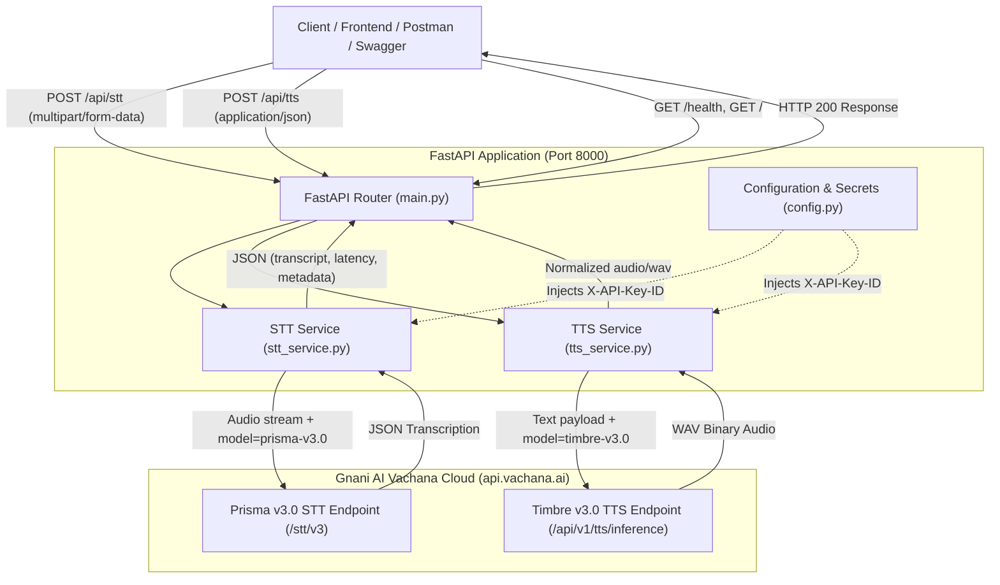
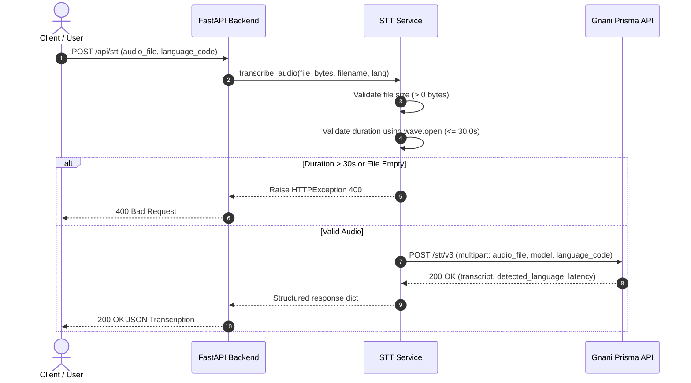
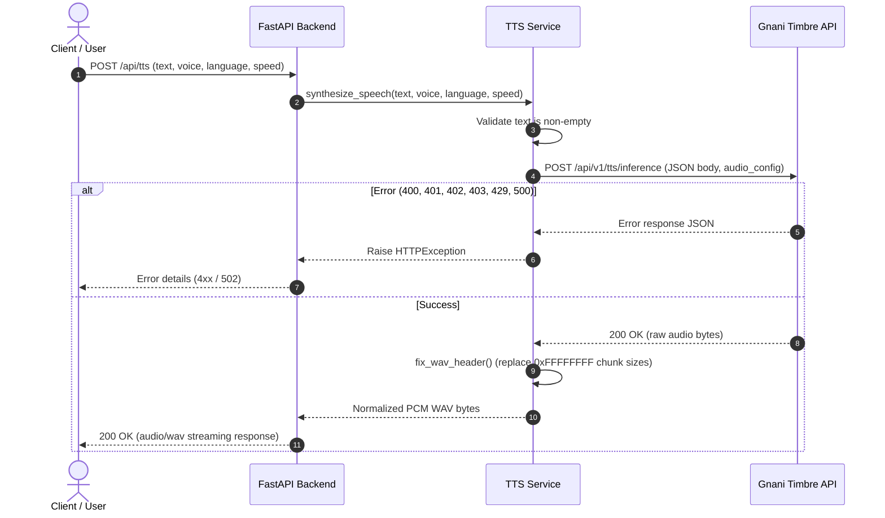

# Multilingual Voice Services Platform: Gnani AI STT & TTS Integration

A production-grade Python backend integration featuring **Speech-to-Text (STT)** powered by Gnani AI's **Prisma v3.0** engine and **Text-to-Speech (TTS)** powered by Gnani AI's **Timbre v3.0** engine, built with **FastAPI**.

---

## 1. Project Overview

This project implements an end-to-end voice platform developed for the Gnani AI internship challenge. It integrates state-of-the-art multilingual speech technologies optimized for Indic languages and code-switching into a unified, secure RESTful backend API.

The platform exposes standardized endpoints to:
1. **Transcribe recorded speech** in Indian languages (specifically Tamil `ta-IN`, English `en-IN`, Hindi `hi-IN`, or `indic-auto`) with short-clip REST processing under 30 seconds.
2. **Synthesize natural speech** from text input across multiple native Indian voice personas using neural waveform generation.
3. **Validate and normalize audio containers** (including streaming PCM WAV headers) to guarantee full compatibility with operating systems and media players.

---

## 2. Problem Statement

Indian languages present unique linguistic challenges for voice interfaces, including dialectal variation, phonetic diversity, and pervasive conversational code-switching (e.g., Tanglish, Hinglish). Generic global speech engines frequently struggle with Indian accents and vocabulary. Gnani AI provides dedicated models:
- **Prisma v3.0**: Acoustic and language models fine-tuned on Indic speech data.
- **Timbre v3.0**: Multi-speaker neural text-to-speech synthesis with expressive Indian voice personas.

The goal of this internship challenge is to implement robust API clients for both services, resolve data-streaming and connection challenges, and package them into an enterprise-ready FastAPI microservice with automated testing.

---

## 3. Key Objectives

- **API Integration**: Connect directly to Gnani AI's official endpoints (`https://api.vachana.ai/stt/v3` and `https://api.vachana.ai/api/v1/tts/inference`).
- **Resilient Network Handling**: Support multi-megabyte binary uploads with custom socket timeouts and protocol error diagnostics.
- **Audio Validation**: Enforce duration bounds (≤30 seconds) and normalize streaming WAV headers.
- **FastAPI Architecture**: Build modular services, clean Pydantic schemas, and interactive OpenAPI documentation.
- **Comprehensive Quality Assurance**: Achieve 100% automated test coverage with mocks while validating real end-to-end requests with live API credentials.

---

## 4. Technologies Used

- **Frontend SPA**: React 18, Vite 6, Tailwind CSS, Framer Motion, Lucide React
- **Backend API**: Python 3.11+, FastAPI (High-performance ASGI framework)
- **ASGI Server**: Uvicorn (Lightning-fast ASGI web server)
- **HTTP Client**: Requests & Urllib3 (Custom connection and streaming timeout configuration)
- **Validation**: Pydantic v2 (Data validation and schema generation)
- **Audio Processing**: Python Standard Library `wave` and `struct` (Zero external C-dependency audio inspection)
- **Environment Management**: `python-dotenv` (Secure environment isolation)
- **Testing**: Pytest & FastAPI `TestClient` (Automated unit and integration testing)

---

## 5. Architecture & System Workflow



---

## 6. Speech-to-Text (STT) Workflow



---

## 7. Text-to-Speech (TTS) Workflow



---

## 8. Project Structure

```text
gnani-internship/
│
├── backend/                        # FastAPI Application Package
│   ├── __init__.py                 # Package initializer
│   ├── config.py                   # Central configuration & secrets loader
│   ├── main.py                     # FastAPI entrypoint, endpoints & CORS
│   └── services/                   # Modular service layer
│       ├── __init__.py
│       ├── stt_service.py          # Prisma v3.0 STT client & duration parser
│       └── tts_service.py          # Timbre v3.0 TTS client & header normalizer
│
├── tests/                          # Automated Pytest Suite
│   ├── __init__.py
│   └── test_backend.py             # 16 unit & integration tests with mocks
│
├── .env                            # Private API credentials (Git-ignored)
├── .gitignore                      # Git exclusion rules
├── pytest.ini                      # Pytest discovery settings
├── requirements.txt                # Production & test dependencies
│
├── test_stt.py                     # Standalone STT CLI verification script
├── test_stt_suite.py               # Standalone STT unit tests (9 tests)
├── test_tts.py                     # Standalone TTS CLI verification script
├── test_tts_suite.py               # Standalone TTS unit tests (10 tests)
├── verify_e2e_live.py              # Live end-to-end FastAPI verification script
│
├── recording.wav                   # 27.99s sample WAV recording (Tamil)
├── generated_speech.wav            # Standalone synthesized speech output
├── fastapi_live_output.wav         # Live FastAPI pipeline synthesized audio
│
├── DEMO_GUIDE.md                   # Complete internship demonstration manual
├── SUBMISSION_CHECKLIST.md         # Final verification checklist
└── README.md                       # Project documentation
```

---

## 9. Prerequisites

- **Python**: Version 3.10, 3.11, or 3.12
- **Operating System**: Windows, Linux, or macOS
- **Network**: Outbound HTTPS connectivity to `api.vachana.ai` on port 443

---

## 10. Installation Instructions

1. Clone or navigate to the project directory:
   ```powershell
   cd D:\gnani-internship
   ```

2. (Optional) Create and activate a Python virtual environment:
   ```powershell
   python -m venv venv
   .\venv\Scripts\Activate.ps1
   ```

3. Install backend dependencies:
   ```powershell
   pip install -r requirements.txt
   ```

4. Install frontend dependencies:
   ```powershell
   cd frontend
   npm install
   cd ..
   ```

---

## 11. Environment Configuration

The application reads API credentials securely from `.env`. The file is tracked in `.gitignore` to prevent secret exposure.

Create or edit `.env` in the root folder:
```env
# Gnani AI API Key (Single key provides access to both STT & TTS)
GNANI_API_KEY=your_api_key_here
```

> [!NOTE]
> Do not put quotes around the key or spaces around the `=` sign. The application reads `GNANI_API_KEY` dynamically.

---

## 12. How to Run the Application

### A. Start the FastAPI Backend:
```powershell
uvicorn backend.main:app --reload --host 127.0.0.1 --port 8000
```

Verify backend in your browser:
- **Root Info**: [http://127.0.0.1:8000/](http://127.0.0.1:8000/)
- **Health Check**: [http://127.0.0.1:8000/health](http://127.0.0.1:8000/health)
- **Interactive Swagger Docs**: [http://127.0.0.1:8000/docs](http://127.0.0.1:8000/docs)
- **Direct Frontend UI (Mounted)**: [http://127.0.0.1:8000/app](http://127.0.0.1:8000/app)

### B. Start the React + Vite Development Frontend (Optional with Hot Reload):
In a second terminal window:
```powershell
cd frontend
npm run dev
```
Open [http://localhost:5173/](http://localhost:5173/) to interact with the responsive AI SaaS web application.

---

## 13. API Endpoints Reference

### 1. Root Information
- **URL**: `GET /`
- **Description**: Returns basic service metadata and documentation URLs.
- **Response**:
  ```json
  {
    "message": "Welcome to Gnani AI Voice Services API",
    "version": "1.0.0",
    "documentation": "/docs"
  }
  ```

### 2. Health Check
- **URL**: `GET /health`
- **Description**: Lightweight health monitor that confirms application status and API key configuration without consuming API credits.
- **Response**:
  ```json
  {
    "status": "healthy",
    "api_key_configured": true,
    "services": {
      "stt": "ready",
      "tts": "ready"
    }
  }
  ```

### 3. Speech-to-Text (STT)
- **URL**: `POST /api/stt`
- **Content-Type**: `multipart/form-data`
- **Parameters**:
  - `file` *(Binary, Required)*: Audio recording (WAV format, max 30s).
  - `language_code` *(Form string, Optional)*: Target language. Default: `ta-IN`.
- **Response (200 OK)**:
  ```json
  {
    "success": true,
    "transcript": "டேக் அ டீப் ப்ரெத் அண்ட் பாஸ் ஃபார் அ மோமெண்ட்...",
    "detected_language_code": "ta-IN",
    "model": "prisma-v3.0",
    "processing_time": 0.50,
    "end_to_end_latency": 12.35,
    "request_id": "01a1dae9-6df4-74ba-817e-57c8ea9095d5"
  }
  ```

### 4. Text-to-Speech (TTS)
- **URL**: `POST /api/tts`
- **Content-Type**: `application/json`
- **Request Body**:
  ```json
  {
    "text": "வணக்கம்! ஞானி ஏஐயின் குரல் சேவைக்கு நல்வரவு.",
    "voice": "Lakshmi",
    "language": "ta-IN",
    "speed": 1.0
  }
  ```
- **Response (200 OK)**:
  - Header: `Content-Type: audio/wav`
  - Body: Binary PCM WAV audio stream (`attachment; filename=synthesized_speech.wav`).

---

## 14. Testing Guide

### A. Run All Automated Pytest Tests (35 Tests, 100% Mocked)
Automated tests mock external Gnani API calls so they run instantly without consuming quota or requiring active network access:

```powershell
python -m pytest -v
```
*(All 35 tests pass with 0 failures).*

### B. Run Individual Test Suites
- **Backend API Suite**: `python -m pytest -v tests/test_backend.py` (16 tests)
- **Standalone STT Suite**: `python test_stt_suite.py` (9 tests)
- **Standalone TTS Suite**: `python test_tts_suite.py` (10 tests)

### C. Run Live End-to-End Verification (Real Gnani AI Calls)
To verify the complete live pipeline (Audio $\rightarrow$ FastAPI $\rightarrow$ Gnani $\rightarrow$ Output):

```powershell
python verify_e2e_live.py
```

Output:
```text
=================================================================
 1. TESTING LIVE SPEECH-TO-TEXT THROUGH FASTAPI (POST /api/stt)
=================================================================
[✓] Uploading 'recording.wav' (2,468,796 bytes) to /api/stt...
HTTP Status: 200
[✓] Transcription received:
"டேக் அ டீப் ப்ரெத் அண்ட் பாஸ் ஃபார் அ மோமெண்ட்..."

=================================================================
 2. TESTING LIVE TEXT-TO-SPEECH THROUGH FASTAPI (POST /api/tts)
=================================================================
[✓] Requesting speech synthesis for Tamil text...
HTTP Status: 200
[✓] Received 606,764 bytes of audio in 12.41s.
[✓] Verified audio file 'fastapi_live_output.wav':
    Channels:     1 (Mono)
    Sample Rate:  48000 Hz
    Duration:     6.32 seconds

=================================================================
 LIVE PIPELINE SUMMARY: STT=PASSED | TTS=PASSED
=================================================================
```

---

## 15. Error Handling & Security

1. **Credential Isolation**:
   - `GNANI_API_KEY` is loaded strictly from environment variables.
   - The key is omitted from HTTP error responses, application logs, and Git history.
2. **Network Timeouts**:
   - Audio file uploads use an extended timeout (90 seconds) to prevent socket write timeouts during TLS transfers of multi-megabyte audio files.
3. **HTTP Status Code Mapping**:
   - `400 Bad Request`: Empty files, missing text, unsupported voice names, or duration exceeding 30s.
   - `401 Unauthorized`: Invalid or missing Gnani API key.
   - `402 Payment Required`: Insufficient credits on Gnani AI account.
   - `403 Forbidden`: Missing permissions for STT/TTS service.
   - `429 Too Many Requests`: Rate limit exceeded.
   - `502 Bad Gateway`: External Gnani AI server errors.
   - `504 Gateway Timeout`: Network or server timeouts.

---

## 16. Limitations & Future Improvements

- **Streaming WebSocket Support**: Prisma v3.0 and Timbre v3.0 both offer real-time streaming interfaces (`/stt/v3/stream` and `/api/v1/tts/sse`); future updates can add WebSocket handlers for sub-second latency.
- **Batch Processing**: Support asynchronous batch jobs for files exceeding the 30-second REST limit.

---

## 17. Production Deployment Guide (Render Blueprint)

VoxAI is configured for automated unified full-stack deployment on **Render** via Infrastructure-as-Code using the root [`render.yaml`](render.yaml) blueprint specification. In this unified architecture, the FastAPI backend serves both the REST API endpoints and the compiled React single-page application from the same origin under HTTPS.

### Automated Deployment Steps

1. **Prerequisite**:
   - Ensure the production-preparation branch (`cleanup/voxai-production-ready`) is merged into the `main` branch on GitHub.

2. **Deploy with Render Blueprint**:
   - Navigate to the [Render Dashboard](https://dashboard.render.com).
   - Click **New +** $\rightarrow$ **Blueprint**.
   - Connect your GitHub repository and select the `main` branch.
   - Render will detect [`render.yaml`](render.yaml) and automatically configure the `voxai-speech-platform` web service.

3. **Configure Environment Variables**:
   - Because `render.yaml` specifies `sync: false` for sensitive credentials, Render will prompt for `GNANI_API_KEY`.
   - Enter your valid Gnani API key securely in the Render environment variables prompt (or under the service's **Environment** tab).
   - *Never commit your raw API key to Git.*

4. **Service Execution Details**:
   - Render executes the exact build and start commands defined in `render.yaml`:
     - **Build Command**:
       ```bash
       npm --prefix frontend ci && npm --prefix frontend run build && pip install -r requirements.txt
       ```
     - **Start Command**:
       ```bash
       uvicorn backend.main:app --host 0.0.0.0 --port $PORT
       ```

5. **Verify Live Deployment**:
   - Render automatically provisions free SSL/TLS certificates. **HTTPS is required** for browser microphone recording permissions (`navigator.mediaDevices.getUserMedia`).
   - Open your deployed service URL:
     - Web Application: `https://<service-name>.onrender.com/` (browser traffic automatically redirects to `/app/`).
     - Interactive Swagger API Documentation: `https://<service-name>.onrender.com/docs`.
     - System Health Endpoint: `https://<service-name>.onrender.com/health`.
